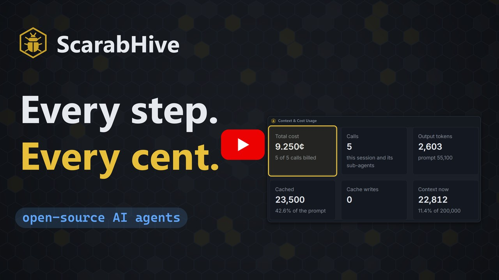
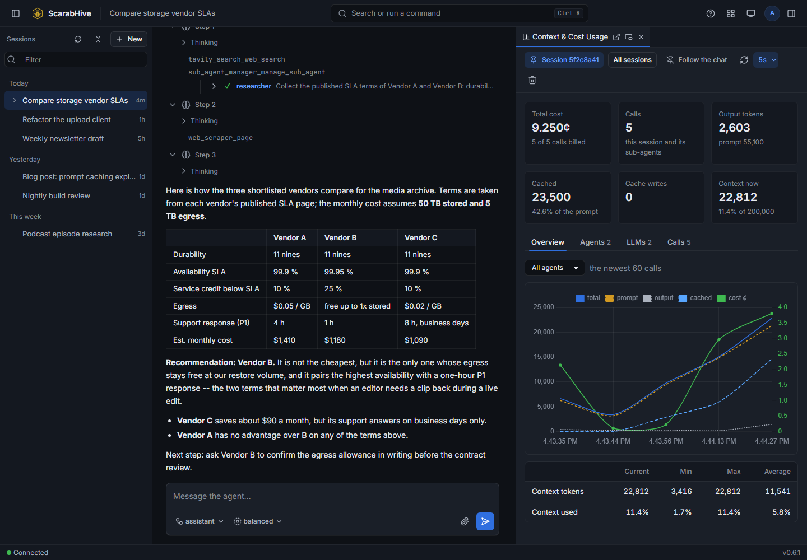
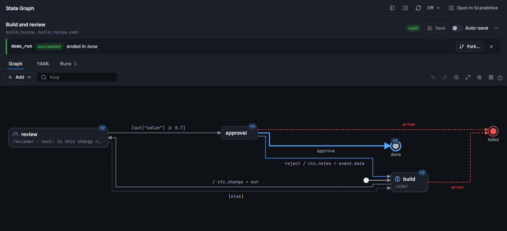
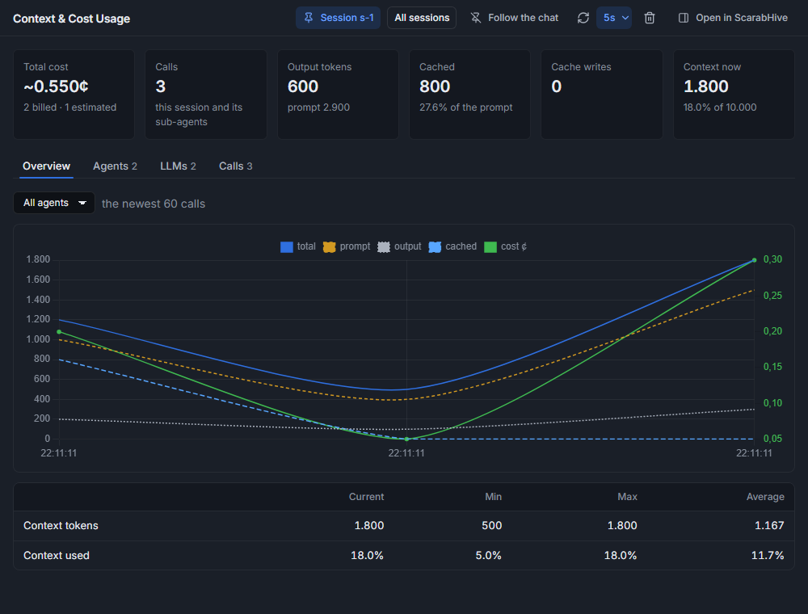
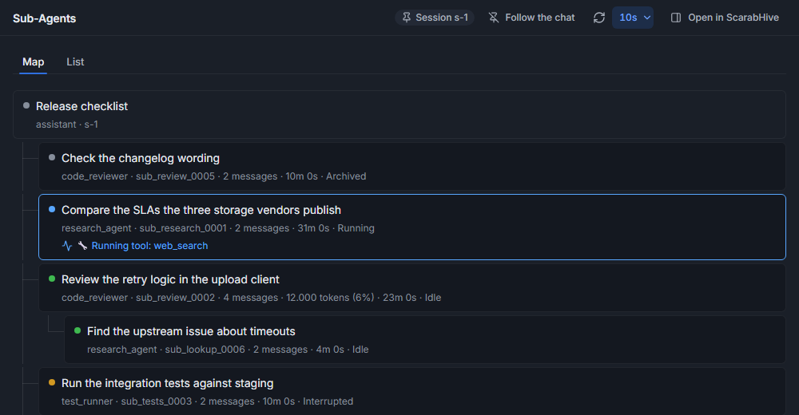
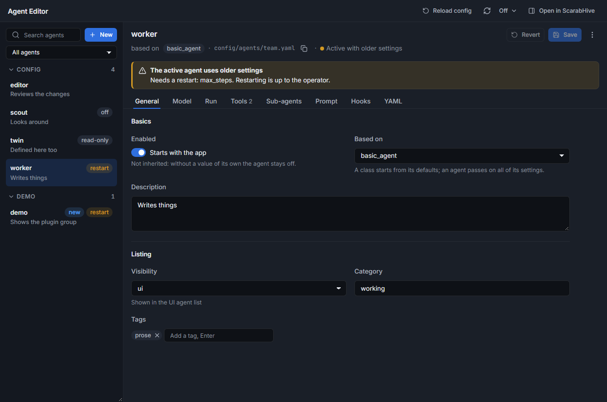
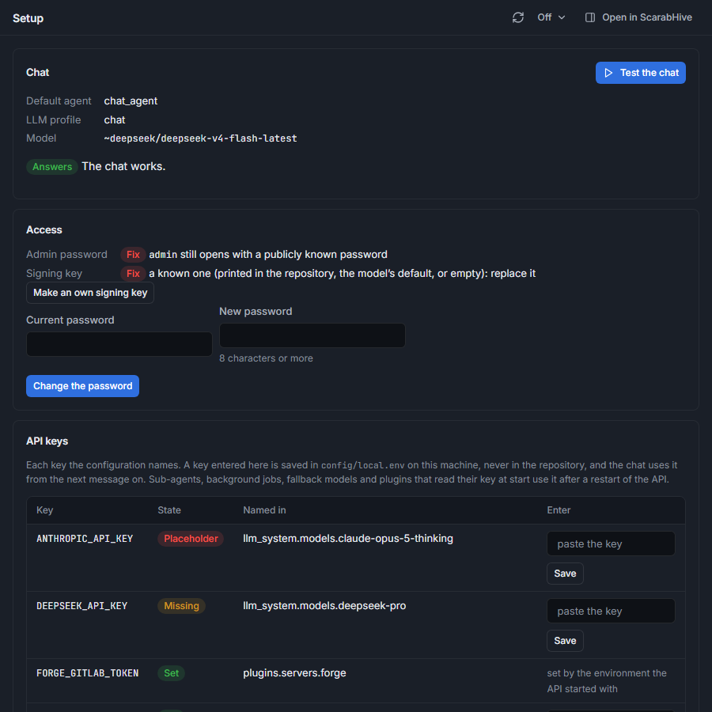

# ScarabHive

[](LICENSE)
[](https://www.python.org/)

[](https://www.youtube.com/watch?v=IQx1PrSRp5Q&list=PLVydEHPBKRiI)

**The right model for every agent, as much structure as each task needs -- and a live view of
what every agent really does.**

ScarabHive is a self-hosted framework for LLM agents, built entirely on plugins. You define an
agent in YAML -- its model, its prompt, the few tools it may use -- and run it in the browser,
from the command line or as a model behind an OpenAI-compatible API.

**Built on current technology throughout**: the providers' newest APIs and features -- OpenAI's
Responses and Realtime APIs, extended and adaptive thinking, prompt-cache breakpoints, batch
APIs -- and the open standards around agents: MCP (stdio and streamable HTTP), the
[Agent Skills](https://agentskills.io) format and OpenTelemetry's GenAI conventions. CI runs on
Python 3.11, 3.12 and 3.14.

It is made for three kinds of users:

- **Developers** who build on agents: plugins in plain Python, scripted runs, agents called as
  models from their own code, and a coding agent that works in their repositories.
- **Teams that bring agents into their company's workflows**: users and roles, an
  OpenAI-compatible API, n8n, external MCP servers, Docker.
- **Content creators** who build multi-step workflows -- research, images, audio, video --
  from agents and tools, with little or no code.

<a href="https://www.youtube.com/watch?v=IQx1PrSRp5Q&list=PLVydEHPBKRiI"></a>

▶ **Watch the [ScarabHive playlist](https://www.youtube.com/watch?v=IQx1PrSRp5Q&list=PLVydEHPBKRiI) on YouTube.**



> [!WARNING]
> **ScarabHive is beta software.** It is under heavy development and **may contain serious
> bugs**, including ones that lose data, run up LLM costs or weaken security. Behaviour,
> configuration and APIs can change without notice. Do not expose it to the internet or to
> people you do not trust. Keep backups of everything under `data/`, and watch your providers'
> spending limits. Please report problems (security issues privately, see [SECURITY.md](SECURITY.md)).

## Why ScarabHive

### The right model for every agent

- **One model per job.** Every agent names its own LLM profile: a cheap, fast model for
  summaries and lookups, a strong one for code or judgement. Sub-agents and plugins (a
  summariser, for example) name their own. A profile is a fallback chain: when a model fails or
  is rate-limited, the next one takes over.
- **A stronger model when the task gets hard.** An agent can carry a second, stronger chain. A
  caller asks for it when it hands over a hard task. With `auto_escalate_on_stuck` switched on,
  the run also switches up by itself when it gets stuck -- caught in a tool-call loop, or failing
  tool after tool -- for a few steps within a call budget, then drops back to the normal model
  ([LLM profiles](docs/basic_agent_llm_profiles.md)).
- **Any provider, local models included.** OpenAI (Chat Completions and Responses), Anthropic,
  Google Gemini, OpenRouter, DeepSeek, Ollama, and any OpenAI-compatible server such as vLLM or
  llama.cpp. Batch APIs for Gemini, OpenAI and Anthropic, picked like any other model
  ([batch](docs/llm_batch_api.md)).
- **Your Claude Code subscription as a tool** *(experimental)*. An agent can hand a coding task
  to Claude Code, which runs on your Claude Code login instead of an API key, in an isolated
  copy of the repository; its changes come back for you to review
  ([coding_cli](src/plugins/coding_cli/README.md)).

### As much freedom as the task needs

Pick the structure that fits, from loose to fixed:

1. **One agent that does it all**, with [skills](skills/README.md) (packaged instructions it
   loads when needed) and [OKF](src/plugins/okf/README.md) knowledge bundles (Markdown files
   linked into a graph, which it reads and keeps up to date).
2. **One agent with specialised sub-agents**, each with its own model and only the tools its job
   needs. The coding agent that ships works this way: an explorer and a reviewer that can only
   read, a test runner, and the coder that writes. Sub-agents run in parallel or in the
   background and wake their caller when done ([sub-agents](docs/sub_agent_usage.md)).
3. **A fixed workflow as a state machine** *(young: 0.1)*. Agents, tools and Python functions are
   the steps; branches, parallel steps and a person's approval are part of the graph. Runs are
   journaled and resume after a crash, and a graph editor with breakpoints and watchpoints
   debugs them ([stategraph](src/plugins/stategraph/README.md)). A machine can itself be offered
   as an agent.



### Built to spend less

- **Optimised for the prompt cache.** Each request extends the previous one; nothing that
  changes from call to call sits at the front, and tests guard it. Cache breakpoints and cache
  keys are set where a provider needs them.
- **A context that stays lean.** For agents that switch on the context engineer (the shipped
  multi-turn agents do), large tool results move out of the context and stay readable on demand,
  and long conversations are compacted. Old messages are summarised by a cheap model.
- **Fewer turns and fewer tokens.** A script can chain several dependent tool calls in one model
  turn; predictable opening tool calls can run before the first LLM call; rarely used tools reach
  the model as a name and one line until it asks for them -- for the coding agent that made the
  first prompt 31 % smaller in a paired run ([measured](docs/deferred_tools.md)).
- **Runs that stop wasting.** Tool-call loops and reasoning loops are detected and stopped, and
  a message you send while an agent works reaches it at its next step.

### See what the model really does

- **While it runs**: every LLM step with its thinking, every tool call with its result, and every
  sub-agent, live in the chat; a map of all sub-agents of a session and what each one is doing.
- **Down to the wire**: the raw requests and responses each model got and gave, in the Message
  Debugger.
- **What it cost**: tokens, cache hits and cost of every call, per session, agent and model.
- **A second opinion**, for agents that switch it on: a watchdog in which a cheap model judges
  every few steps whether a run is still making progress. Traces can go to OpenTelemetry once
  you enable that plugin.

## Getting started

You need Python 3.11 or newer (3.12 recommended), git, about 2 GB of disk and an LLM provider.
For the simplest start, take an [OpenRouter API key](https://openrouter.ai/keys): as shipped,
every agent that is switched on runs on OpenRouter. To use OpenAI, Anthropic,
Google Gemini, DeepSeek or a local Ollama instead, point the profiles in `config/llm.yaml` and
`config/llm_openrouter.yaml` at their models ([how](docs/configuration.md#the-shipped-profiles)).

```bash
git clone https://github.com/eehrich/ScarabHive.git ScarabHive
cd ScarabHive
./install.sh                                            # Linux, macOS, Git Bash
powershell -ExecutionPolicy Bypass -File install.ps1    # Windows PowerShell
```

The script installs everything into `.venv`, creates a signing key for this installation, asks
for a password for the `admin` account (Enter generates one) and opens `http://127.0.0.1:8000`.
Log in as `admin`, open the **Setup** panel and enter your key.

Docker, a manual installation and troubleshooting: [INSTALLATION.md](INSTALLATION.md).

## Built on plugins

**Everything is a plugin** -- tools, hooks around the model call, panels in the UI, agents with
their prompts and skills, slash commands, even the LLM providers. About 75 ship with it.

- **An agent gets only the tools it needs.** Its allowlist starts empty; patterns allow and deny
  tools per plugin instance, and rarely used ones can be deferred. An agent can also be put in
  ask mode, where a person approves each tool call before it runs. Fewer tools mean a smaller
  attack surface and fewer tokens on every call.
- **Built for debugging.** The Message Debugger, the cost panel, a log viewer, the state-machine
  debugger, `agent-cli hooks inspect`, and a Help panel with a manual for every plugin -- for
  those that give the model tools, exactly what the model sees of them.
- **Your own plugin is a small folder.** Three files for a tool, a panel built on the shipped UI
  kit, hooks before and after every LLM call. Skills that know how plugins and panels are built
  ship with the repository, for Claude Code and for ScarabHive's own coding agent
  ([plugin-authoring](.claude/skills/plugin-authoring/SKILL.md),
  [panel-authoring](.claude/skills/panel-authoring/SKILL.md)); validators check the result.

A complete tool plugin:

```toml
# src/plugins/greeter/plugin.toml
[plugin]
name = "greeter"
version = "0.1.0"
description = "Greets people."
entrypoint = "plugin:PLUGIN_FACTORY"
type = ["tool-server"]
requires = { agent_system = ">=0.6.0" }
```

```yaml
# src/plugins/greeter/schema.yaml -- what the model sees
tools:
  - type: function
    function:
      name: "{{ name }}_hello"
      description: Greet a person by name.
      parameters:
        type: object
        properties:
          who: {type: string}
        required: [who]
```

```python
# src/plugins/greeter/plugin.py -- one method per tool
from typing import Any

from agent_system.tools.schema_based import SchemaBasedToolServer


class GreeterServer(SchemaBasedToolServer):
    async def hello(self, params: dict[str, Any]) -> dict[str, Any]:
        return {"status": "success", "greeting": f"Hello, {params.get('who')}!"}


PLUGIN_FACTORY = GreeterServer
```

Switch it on in `config/plugins.yaml` (`greeter: {type: greeter, enabled: true}` under
`plugins: servers:`) and give an agent `+greeter/*` in its tool list. A tool plugin can run
several times under different names with different settings. An agent that needs no code of its
own -- a prompt, a model, some tools -- is a YAML file and no plugin at all.

More: [docs/plugin_authoring.md](docs/plugin_authoring.md), [docs/plugin_hooks.md](docs/plugin_hooks.md)
and the [example plugin](src/plugins/example/).

## Web UI, CLI and API

- **Web UI**: a streaming chat with sessions per user, and panels you dock as tabs or open as
  windows -- agents, sub-agents, state machines, costs, raw requests, logs, setup and more.
- **CLI**: `agent-cli chat` and `agent-cli run` work without a server and share the sessions with
  the web UI; `agent-run` for scripted runs ([CLI reference](docs/cli_reference.md)).
- **API**: every agent is a model behind an OpenAI-compatible endpoint (`/chat/completions` and
  `/responses`, text in and out), next to the REST and streaming API the web UI uses
  ([openai_api](src/plugins/openai_api/README.md)).

**In a company setting**: users with roles, API keys and route security per role; n8n workflows
built as drafts and tested with every outbound call mocked; external MCP servers as tools;
Docker Compose.

## What ships with it

- **Files and shell**: file operations confined to configured folders; a terminal (unrestricted
  by default -- a command whitelist, or write confinement on Linux and macOS, narrows it); file
  checkpoints with undo, SSH to remote machines, SQLite queries.
- **Web**: search (Tavily, DuckDuckGo), page scraping, a research agent that answers with sources.
- **Knowledge**: memory, a todo list, lessons an agent learns from its runs, skills, OKF bundles.
- **Development**: the coding agent with its sub-agents, Claude Code as a delegate, Godot and
  Blender agents.
- **Media**: images, audio and video into and out of the context, image composition, ComfyUI.

## A look inside

| | |
|---|---|
|  |  |
| Cost, tokens and cache use of every call | The sub-agents of a session as a map |
|  |  |
| Agents edited in a form, their YAML and comments kept | Setup: what the installation still lacks |

## Documentation

- [INSTALLATION.md](INSTALLATION.md) — from a checkout to the first login
- [docs/configuration.md](docs/configuration.md) — models, plugins, agents, authentication
- The **Help** panel in the UI — the manual for the framework and each plugin
  (`docs/guides/`, `src/plugins/<name>/<name>.guide`)
- [docs/plugin_authoring.md](docs/plugin_authoring.md) and [docs/plugin_hooks.md](docs/plugin_hooks.md)
  — writing your own plugins
- [docs/](docs/) — architecture and design notes

## Contributing

See [CONTRIBUTING.md](CONTRIBUTING.md). Report security vulnerabilities privately, as described
in [SECURITY.md](SECURITY.md).

## License

Apache License 2.0, see [LICENSE](LICENSE).

## Author

Enrico Ehrich
